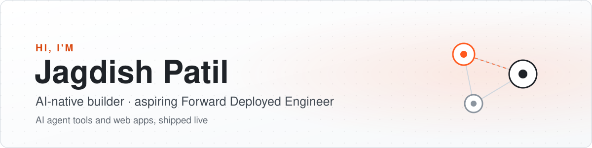

  <picture>
    <source media="(prefers-color-scheme: dark)" srcset="assets/banner-dark.svg">
    
  </picture>

  
  

I'm a college student who builds **AI agent tools and web apps**, and ships them live. Most of what I make is
multi-agent: AI teams that plan, check each other's work and hand you something you can use. I'm working toward
becoming a **Forward Deployed Engineer**: someone who takes AI from a demo to a working product for real users.

## 🔭 Featured projects

**[GlassBoxAPK](https://github.com/jagdish3135/glassboxapk)** · [glassboxapk.vercel.app](https://glassboxapk.vercel.app) 
Hand your AI coding agent an Android APK and watch how the app works: an animated, code-linked system design explainer, with PPT and PDF export. 
React · Vite · TypeScript · jadx · works with Claude Code, Codex and Cursor

**[LexAgent](https://github.com/jagdish3135/lexagent)** · [lexagent-phi.vercel.app](https://lexagent-phi.vercel.app) 
Four AI agents read Indian legal case files (English, Hindi, Marathi and more), cross-check each other and hand you a PDF brief. Decision support, not a decision. 
Next.js · TypeScript · Mistral, Groq or Gemini · OCR with Tesseract

**[JanDrishti](https://github.com/jagdish3135/jandrishti)** · [jandrishti-app.vercel.app](https://jandrishti-app.vercel.app) 
One portal for civic complaints. Every complaint gets a named officer and a deadline, a missed deadline moves it to the senior officer automatically, and it closes only with a new on-site photo that is checked for reuse. In English, हिन्दी and मराठी, with large text for older citizens. 
React · Vite · TypeScript · Leaflet + OpenStreetMap · built with Knit

**[Knit](https://github.com/jagdish3135/knit)** · [jagdish3135.github.io/knit](https://jagdish3135.github.io/knit/) 
A multi-agent software team for Claude Code, Codex, Cursor, OpenCode and Antigravity. It plans, builds, tests, reviews and ships, and you approve each step. LexAgent was built with it. 
Claude Code subagents and skills · 13 agents plus 8 on call

## 🛠️ What I build with

  
  
  
  
  
  
  
  
   
  
  
  
  
  
  

## 📊 GitHub stats

  <picture>
    <source media="(prefers-color-scheme: dark)" srcset="https://github-readme-stats.vercel.app/api/top-langs/?username=jagdish3135&layout=compact&langs_count=5&hide_border=true&card_width=320&theme=github_dark">
    
  </picture>
  <picture>
    <source media="(prefers-color-scheme: dark)" srcset="https://streak-stats.demolab.com/?user=jagdish3135&theme=github-dark-blue&hide_border=true">
    
  </picture>

